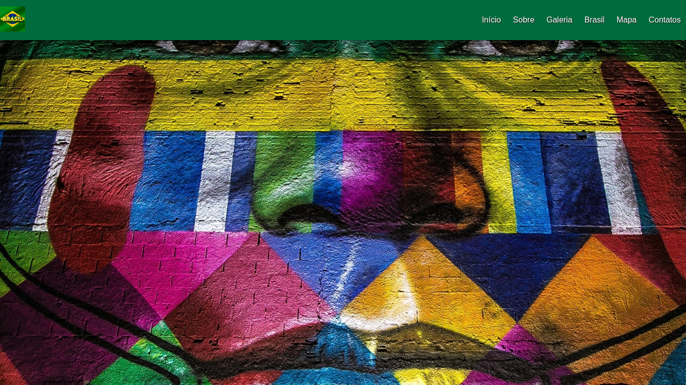
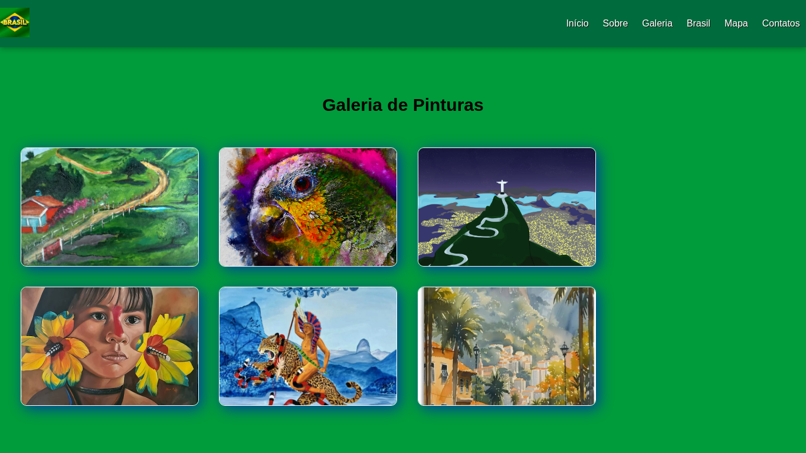

# Brasil em Telas 🎨

Um site sobre a pintura brasileira, suas cores, paisagens e a diversidade cultural do nosso país.

Desenvolvi este projeto com **Clarice Gabriela**, utilizando **HTML, CSS e um pouco de JavaScript**. A ideia foi reunir imagens e informações em uma página simples, agradável de navegar e que também funcionasse em telas menores.

## 🌎 Sobre o projeto

Organizamos o site em seções para facilitar a navegação:

- **Início:** apresentação do tema e imagem de destaque;
- **Sobre:** uma introdução à pintura brasileira;
- **Galeria:** seleção de imagens que fazem parte do projeto;
- **Brasil:** textos sobre a cultura e as paisagens do país;
- **Mapa:** localização da UDF;
- **Contato:** um formulário demonstrativo.

O formulário é apenas uma demonstração visual: ele exibe um aviso quando é enviado, mas **não encaminha nem armazena mensagens**.

## 🛠️ O que utilizei

- **HTML5** para organizar o conteúdo, as seções e os formulários;
- **CSS3** para trabalhar o visual, a galeria e a adaptação a diferentes telas;
- **JavaScript** para interações simples;
- **Google Maps** para incorporar o mapa de localização.

## 💻 Como visualizar

Não é preciso instalar bibliotecas ou iniciar um servidor.

1. Baixe os arquivos ou clone o repositório:

   ```bash
   git clone https://github.com/mateus-mussi/brasil-em-telas.git
   ```

2. Abra o arquivo `index.html` no navegador.

Também é possível abrir a pasta no VS Code e usar a extensão **Live Server**. O mapa precisa de conexão com a internet.

## 📸 Imagens do site

### Página inicial



### Galeria



As imagens utilizadas na página estão organizadas na pasta `img/`.

## 📁 Organização dos arquivos

```text
brasil-em-telas/
├── index.html
├── css/
│   └── style.css
├── img/
│   ├── logo.webp
│   ├── hero.jpg
│   └── 1.jpg ... 8.jpg
├── docs/
│   ├── inicio.png
│   └── galeria.png
└── README.md
```

## 👥 Quem desenvolveu

**Clarice Gabriela e Mateus Mussi.**

Este foi um trabalho que fizemos juntos, por isso mantenho os créditos dos dois. Ainda precisamos conferir a origem e as condições de uso de cada imagem antes de definir uma licença de reutilização para o repositório.

## 🔧 O que quero melhorar

Pretendo revisar os textos alternativos das imagens, conferir os créditos das obras e testar melhor a navegação, a acessibilidade e o comportamento do layout em celulares.

O projeto continua disponível aqui para mostrar o que desenvolvemos e para acompanhar essas melhorias.
