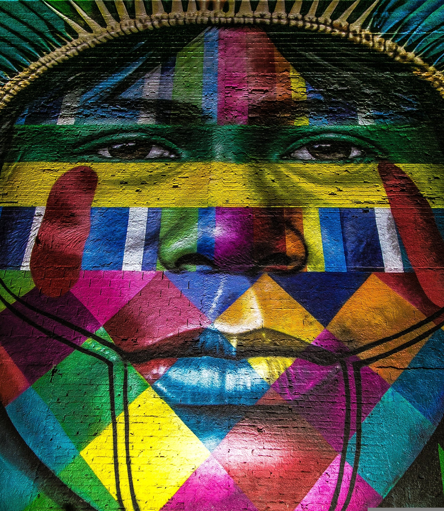

# Brasil em Telas 🎨


## 📚 Projeto acadêmico de 2026.2

| Informação | Detalhe |
|---|---|
| **Projeto** | Brasil em Telas |
| **Disciplina** | **Desenvolvimento Front-End para Web** |
| **Semestre** | **2026.2** |
| **Instituição** | UDF |
| **Curso** | Análise e Desenvolvimento de Sistemas (ADS) |
| **Integrantes citados no código** | Clarice Gabriela e Mateus Mussi |
| **Tecnologias** | HTML5 e CSS3; JavaScript mínimo para o aviso do formulário |

## 📌 Contexto e objetivo

O projeto **Brasil em Telas** apresenta a riqueza da pintura brasileira e a diversidade de paisagens, regiões e manifestações culturais do país em um site de página única. Foi desenvolvido como atividade prática da disciplina Desenvolvimento Front-End para Web, no semestre 2026.2, aplicando estruturação semântica, estilização e navegação por âncoras.

A página reúne uma introdução à pintura brasileira, galeria de imagens, textos sobre a cultura nacional, localização da UDF em um mapa incorporado e um formulário visual de contato.

## ✨ Funcionalidades

- Página inicial com imagem de destaque e identidade visual.
- Barra de navegação entre as seções **Início**, **Sobre**, **Galeria**, **Brasil**, **Mapa** e **Contatos**.
- Galeria com seis imagens do trabalho original.
- Layout com adaptação para telas menores.
- Mapa da UDF incorporado via Google Maps.
- Formulário ilustrativo, sem backend ou transmissão de mensagens. Ao enviar, é exibido apenas um aviso.

## 🛠️ Tecnologias e organização

- **HTML5:** estrutura de páginas, seções, navegação, galeria, formulário e iframe.
- **CSS3:** cores, tipografia, layout flexível, responsividade e efeitos visuais.
- **JavaScript:** comportamento demonstrativo do formulário e sinalização de imagens ausentes.
- **Google Maps Embed:** visualização externa do mapa, dependente de conexão com a internet.

Estrutura esperada do projeto:

```text
brasil-em-telas/
├── index.html
├── css/
│   └── style.css
├── img/
│   ├── logo.webp
│   ├── hero.jpg
│   └── 1.jpg ... 8.jpg
├── docs/
│   └── LEIA-ANTES-DE-PUBLICAR.md
├── .gitignore
└── README.md
```

> ✅ **Pasta `img/` publicada e verificada:** `logo.webp`, `hero.jpg` e `1.jpg` até `8.jpg` estão disponíveis com os caminhos usados no HTML e no CSS. A visualização em navegador ainda deve ser testada.

## ▶️ Como executar localmente

**Pré-requisito:** navegador atualizado (Chrome, Firefox ou Edge). Não há dependências a instalar.

1. Clone o repositório:
   ```bash
   git clone https://github.com/mateus-mussi/brasil-em-telas.git
   cd brasil-em-telas
   ```
2. Abra o arquivo `index.html` no navegador.
3. Alternativamente, abra a pasta no VS Code e inicie a extensão *Live Server*.
4. Navegue pelas seções usando o menu superior.

**Observações:** O mapa necessita de internet. O formulário é demonstrativo; não existe servidor para receber ou salvar os dados.

## 🖼️ Demonstração visual

As imagens originais do trabalho já estão no repositório:



A captura real da interface (**`docs/inicio.png`**) e a captura da galeria (**`docs/galeria.png`**) ainda precisam ser enviadas à pasta `docs/`. Após o upload, poderão ser exibidas aqui como demonstração da página em funcionamento.

## 👥 Autoria e licença

O código original cita **Clarice Gabriela e Mateus Mussi** como responsáveis pelo desenvolvimento. A licença não foi definida: é necessário confirmar a concordância dos autores e os direitos de uso das imagens antes de adicionar um arquivo `LICENSE`. Sem licença, a publicação no GitHub não equivale à autorização para reutilização por terceiros.

## 🔧 Próximas melhorias

- Conferir os créditos e os direitos de uso das imagens publicadas.
- Adicionar capturas de tela reais da página funcionando.
- Refinar textos alternativos das imagens com a identificação de cada obra.
- Realizar testes de acessibilidade e responsividade.
